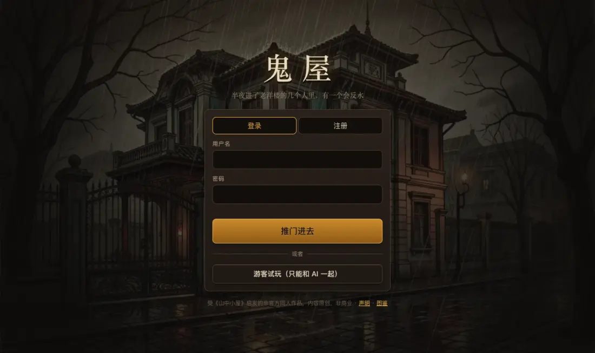
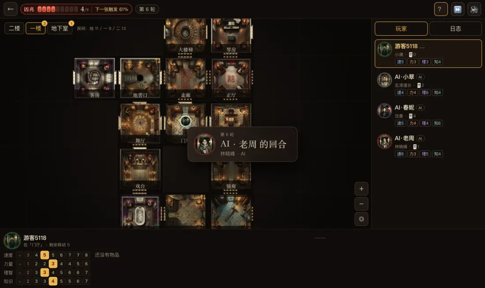
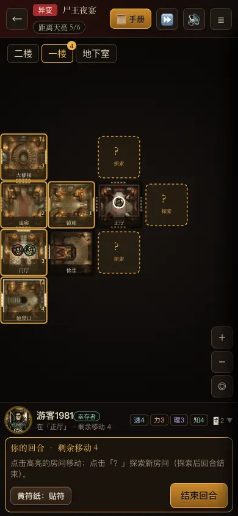
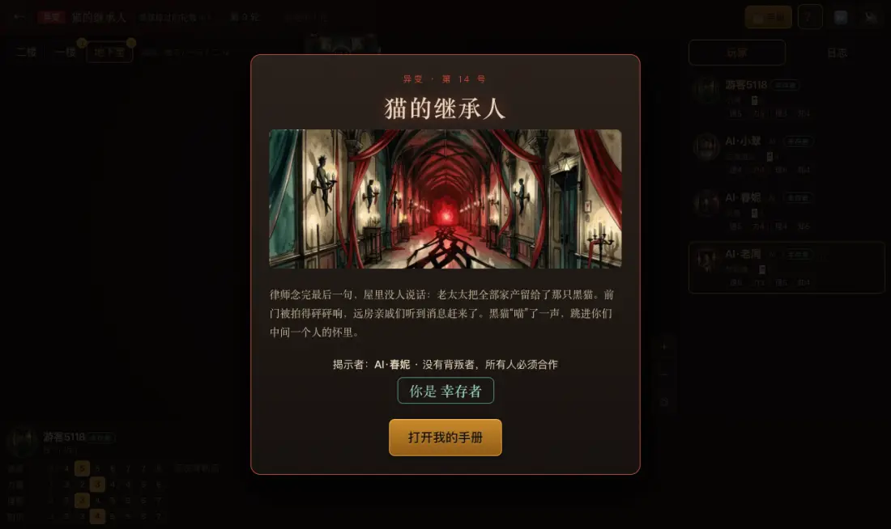
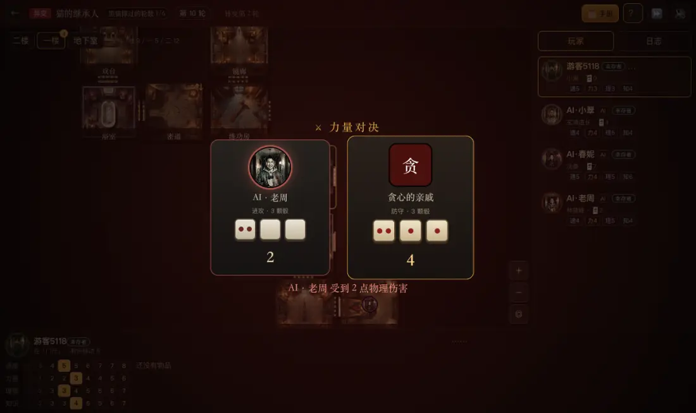
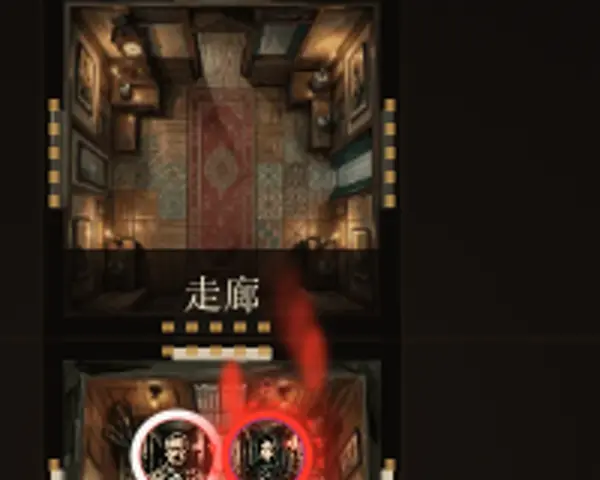

<div align="center">



# 鬼屋

**半夜溜进民国老洋楼的几个人里，有一个会反水。**

3–6 人在线合作 / 背叛桌游 · 浏览器直接玩 · 一个人也能和 AI 开一局


</div>

---

规则框架借自桌游《山中小屋》第 3 版：前半局大家一起探索，凶兆攒够了就触发「异变」，有人变成背叛者，双方各拿一本对方看不到的手册，按自己的目标拼输赢。

设定换成了上海租界的一栋民国西式洋楼，加上纸人、红盖头、绣花鞋、牌位这些中式民俗的东西。角色、房间、卡牌、50 个剧本和全部插画都是重新做的。

## 截图

<table>
  <tr>
    <td width="66%"></td>
    <td rowspan="2"></td>
  </tr>
  <tr>
    <td></td>
  </tr>
  <tr>
    <td></td>
    <td align="center"><br /><sub>背叛者头顶冒着红色怨气</sub></td>
  </tr>
</table>

## 内容

| | 数量 | 说明 |
|---|---|---|
| 探险者 | 12 | 6 块双面角色板：探灵主播、退休消防员、历史系研究生、外卖骑手、风水师、道长、古董商…… |
| 房间 | 5 + 42 | 地下室、一楼、二楼，祠堂、戏台、古井、钟楼、洗衣槽、送菜梯…… |
| 卡牌 | 9 + 22 + 43 | 凶兆、物品、事件 |
| 缘起 | 5 | 探灵直播、遗嘱宣读、失踪的朋友、拆迁前夜、百年诅咒 |
| 异变剧本 | 50 | 单人背叛、隐藏背叛者、全员合作、各自为战四类，总表见 [docs/HAUNTS.md](docs/HAUNTS.md) |

## 怎么玩

1. **探索**：每回合最多走「速度」那么多格。走进没开过的门就翻开一个新房间，按房间符号抽事件、物品或凶兆，这个回合到此结束。
2. **属性**：速度、力量、理智、知识。检定掷「属性值」颗骰子，骰面是 0、0、1、1、2、2。异变之前没人会死。
3. **异变**：每出一张凶兆就掷「凶兆数」颗骰子，5 点以上触发，第 9 张必定触发。缘起卡和这张凶兆决定是哪个剧本、谁当背叛者。
4. **对抗**：手册只有自己这一方能看，用过的规则会公开。属性掉到骷髅就死。同一房间的敌人可以攻击：双方掷力量，高的一方造成差值伤害。

第一次玩可以点大厅里的「新手教程」：和两个 AI 打一局，15 条提示一步步带你走完，不会让你当背叛者，也不限时。

## 在线功能

- 注册账号或游客一键进入；公开房间、房间码、邀请链接
- 空位用 AI 补，掉线 30 秒由 AI 代打，重连后交还
- 回合开始有提示横幅，AI 行动之间会停顿，看得清是谁在做什么
- 骰子、翻牌、异变揭晓、战斗都有动画；音效和背景音乐由 WebAudio 实时合成
- 手机竖屏可玩

## 技术

```
浏览器（Vite + Preact + signals，SVG 地图）
   │  /api/*  /ws/lobby  /ws/house/:id
   ▼
Cloudflare Worker ── 静态资源（前端、插画）
   ├─ D1：账号、战绩
   ├─ LobbyDO：大厅房间列表
   └─ HouseDO：一局一个，SQLite 存回答日志，WebSocket Hibernation
```

- **规则引擎**（`src/engine`）是纯 TypeScript 的生成器协程：需要玩家决策时 `yield` 一个请求。引擎不碰 I/O，随机数带种子，用同样的配置把回答日志重放一遍就能恢复整局。
- **隐藏信息**只从 `Game.viewFor(seat)` 一个出口下发。剧本只在 Worker 端运行，构建后脚本会检查前端产物里有没有剧本文本。
- **剧本**直接用 TypeScript 写，`function*` 里调用引擎 API，见 [docs/CONTENT_GUIDE.md](docs/CONTENT_GUIDE.md)。
- **测试**：每个剧本用 3–6 人跑 6 局 AI 对局，检查能结束、不报错、可以重放。
- **插画**由 Cloudflare Workers AI（FLUX.2）生成，压缩成 WebP，总共约 3 MB。

```
src/engine/    规则引擎、AI
src/content/   探险者、房间、凶兆、物品、事件、缘起（前后端共用）
src/haunts/    50 个异变剧本（只在服务端）
src/worker/    Worker 入口、账号、LobbyDO、HouseDO
src/client/    前端
scripts/       模拟对局、构建检查、插画生成
docs/          调研、计划、内容和文案规范、剧本总表
```

## 本地运行

```bash
npm i
cp .dev.vars.example .dev.vars          # 填 SESSION_SECRET
cp wrangler.jsonc wrangler.local.jsonc  # 填自己的 D1 database_id，这个文件不进仓库
npm run db:migrate:local
npm run dev                             # 前端和 Worker 在同一个 dev server
npm test                                # 引擎 + 50 个剧本
npm run sim -- 20 4                     # 20 局 4 人 AI 对局
```

## 部署到自己的 Cloudflare 账号

```bash
npx wrangler d1 create ghost-house-db   # 把 id 填进 wrangler.local.jsonc
npm run db:migrate
npx wrangler secret put SESSION_SECRET
npm run deploy
```

免费计划就够用。最先用完的额度是 Durable Objects 每天 10 万行写入，按回合合批写入后大约能撑几百局。

## 声明

非官方同人作品，非商业用途。规则框架受《山中小屋》（Betrayal at House on the Hill）启发，与原作及其出版商无关；本仓库里的文字和图片都不来自原作。

代码以 MIT 协议开源。
